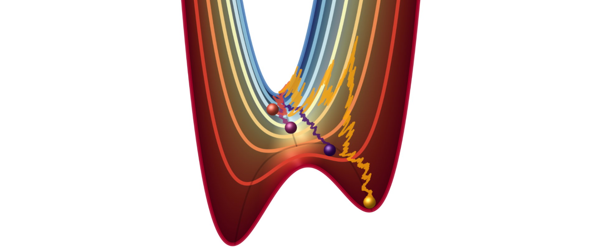

<p align="center"></p>

<h1 align="center"><em>RAD</em>: the rescaled auto-density</h1>

<p align="center">
  <a href="https://doi.org/10.1103/PhysRevX.14.031021"></a>
  <a href="https://doi.org/10.5281/zenodo.12660859"></a>
  <a href="LICENSE"></a>
  <a href="https://time-series-features.gitbook.io/time-series-analysis-tools/time-series-analysis-methods/rad"></a>
</p>

The rescaled auto-density (RAD) is a time-series feature for inferring the distance to criticality (DTC) of a system from a noisy recording of its activity.
Unlike measures such as the standard deviation or the lag-1 autocorrelation, RAD is designed to be insensitive to uncertainty in the strength of the noise driving the system.
It is computed from the shape of the two-dimensional delay embedding of the time series, as the standard deviation of the increments multiplied by the difference between the inverse spreads of the upper and lower halves of the series.
This repository provides RAD in MATLAB, Python and Julia.

📖 **Documentation:** a summary of RAD is on the [time-series analysis tools GitBook](https://time-series-features.gitbook.io/time-series-analysis-tools/time-series-analysis-methods/rad).
Full details are in the paper: B. Harris, L. L. Gollo, and B. D. Fulcher, "[Tracking the distance to criticality in systems with unknown noise](https://doi.org/10.1103/PhysRevX.14.031021)" ([arXiv:2310.14791](https://arxiv.org/abs/2310.14791)).

## Installation

RAD is a single function in a single file per language, so there is nothing to install: clone the repository (or download the file for your language) and put it where your language can find it.

| Language | File | Requirements | Setup |
|---|---|---|---|
| MATLAB | [`RAD.m`](RAD.m) | none (base MATLAB) | add this folder to the path |
| Python | [`RAD.py`](RAD.py) | [NumPy](https://numpy.org) | `pip install numpy`, then `from RAD import RAD` from this folder |
| Julia | [`RAD.jl`](RAD.jl) | [StatsBase.jl](https://github.com/JuliaStats/StatsBase.jl) | `] add StatsBase`, then `include("RAD.jl")` |

```bash
git clone https://github.com/DynamicsAndNeuralSystems/RAD.git
```

## Usage

RAD takes a time series `x` (a vector), a flag for whether to center the series at its median and take absolute values (the centered variant, relevant for signed data, as in the paper's Eq. 12), and a delay `tau` (an integer, in units of the timestep) used for the delay embedding and for the increments.
The output is a single number.

The three implementations differ in the name, default, and position of these arguments:

| Language | Signature | Centering by default? |
|---|---|---|
| MATLAB | `RAD(x, center = 0, tau = 1)` | no |
| Python | `RAD(x, centre = False, tau = 1)` | no |
| Julia | `RAD(z, τ = 1, doAbs = true)` | yes |

To avoid ambiguity, pass the centering flag and `tau` explicitly, as in the examples below.
They apply RAD to the same deterministic test series of 2000 samples and give the same values in all three languages (to the printed precision):

| `RAD` call | Value |
|---|---|
| uncentered, `tau = 1` | 0.0096 |
| centered, `tau = 1` | -0.0110 |
| centered, `tau = 2` | -0.0108 |

**MATLAB**

```matlab
t = (1:2000)';
x = sin(0.3*t) + 0.3*cos(1.7*t) + 0.1*sin(0.011*t.^2);

RAD(x, false, 1)  % uncentered, tau = 1
RAD(x, true, 1)   % centered, tau = 1
RAD(x, true, 2)   % centered, tau = 2
```

**Python**

```python
import numpy as np
from RAD import RAD

t = np.arange(1, 2001)
x = np.sin(0.3*t) + 0.3*np.cos(1.7*t) + 0.1*np.sin(0.011*t**2)

RAD(x, centre=False, tau=1)  # uncentered, tau = 1
RAD(x, centre=True, tau=1)   # centered, tau = 1
RAD(x, centre=True, tau=2)   # centered, tau = 2
```

**Julia**

```julia
using StatsBase
include("RAD.jl")

t = 1:2000
x = @. sin(0.3*t) + 0.3*cos(1.7*t) + 0.1*sin(0.011*t^2)

RAD(x, 1, false)  # uncentered, tau = 1
RAD(x, 1, true)   # centered, tau = 1
RAD(x, 2, true)   # centered, tau = 2
```

RAD needs a series with enough distinct values for both halves of the median split to have a nonzero spread.
It returns `NaN` for a constant series, and `NaN` or `-Inf` for integer-valued or heavily quantized series (for example, spike counts) where many values are tied at the median.

## Other implementations

RAD is also available in other packages in the group's ecosystem:

- [hctsa](https://github.com/benfulcher/hctsa) (MATLAB): the operation `CR_RAD`, used for the features `CR_RAD_1`, `CR_RAD_2` and `CR_RAD_tau`.
- [pyhctsa](https://github.com/DynamicsAndNeuralSystems/pyhctsa) (Python): the corresponding port of the hctsa operation.
- [TimeseriesFeatures.jl](https://github.com/brendanjohnharris/TimeseriesFeatures.jl) (Julia): the `RAD` feature.

## Citation

If you use RAD, please cite the paper:

```bibtex
@article{Harris2024Tracking,
  title   = {Tracking the Distance to Criticality in Systems with Unknown Noise},
  author  = {Harris, Brendan and Gollo, Leonardo L. and Fulcher, Ben D.},
  journal = {Physical Review X},
  volume  = {14},
  pages   = {031021},
  year    = {2024},
  doi     = {10.1103/PhysRevX.14.031021}
}
```

The code is archived on Zenodo: [10.5281/zenodo.12660859](https://doi.org/10.5281/zenodo.12660859).

## License

The code is released under the [MIT License](LICENSE).
